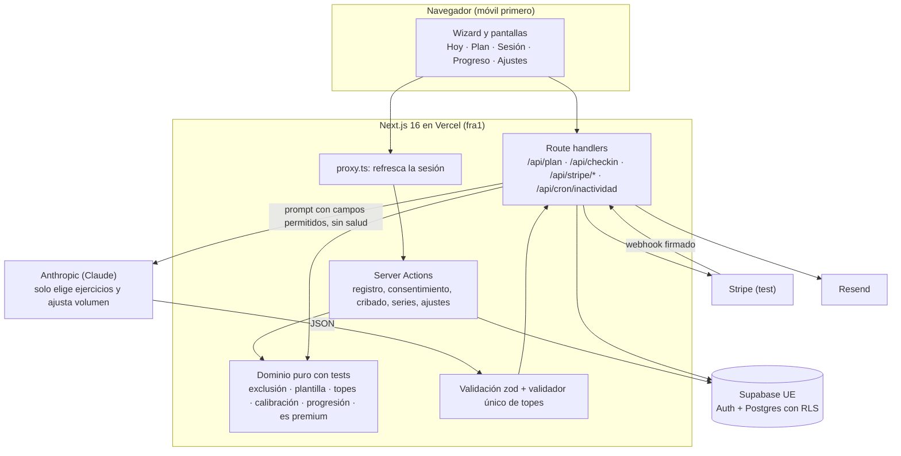

# BUDDY: documento de entrega

Proyecto final del bootcamp Vibe Code Builder (No Code Hackers). Entrega: viernes 20/11/2026 (D38).
Autor: Pablo. Construido con Claude Code.

> BUDDY no es consejo médico ni sustituye a un entrenador certificado.

Leyenda: ✅ cumplido, con evidencia en el repo · ⚠️ sin cumplir, o no se puede verificar desde el repo · "pendiente de confirmar" = el dato no consta en el repo.

---

## 1. Qué es

Una web app, pensada primero para el móvil, para quien entrena por su cuenta en el gimnasio. Un wizard de unos 5 minutos genera un plan con IA a partir de su foco, sus días, el equipo de su gimnasio y sus limitaciones. Después, cada sesión se registra y unas reglas deterministas le dicen qué peso toca.

- **Problema:** quien entrena solo no sabe qué rutina seguir ni cuándo subir peso. Un entrenador es caro, y las apps genéricas no se adaptan a sus limitaciones ni a sus máquinas (PRD §1).
- **Propuesta:** "Tu plan, hecho para ti y para tu gimnasio en 5 minutos, y una sala de máquinas que te dice cada día qué peso toca" (PRD §3).
- **Modelo:** la parte determinista es gratis (plan inicial, registro, refiltrado y sugerencia de carga, D31). Premium son las funciones con IA, a 5 €/mes como hipótesis (D25), con 14 días de prueba (D36).

## 2. Accesos

| Qué | URL |
|---|---|
| Producción | https://buddy-xi-eight.vercel.app |
| Repo público | https://github.com/PGC-12thdivision/buddy |
| Staging (preview con Vercel Authentication: solo entra Pablo) | https://buddy-git-staging-let-me-think12th-division.vercel.app |
| Loom | ⚠️ pendiente de grabar (guion en `docs/entrega/guion-loom-4min.md`) |
| Índice de la documentación | [`docs/README.md`](../README.md) |
| Guía de uso (no técnica) | [`docs/guia-de-uso.md`](../guia-de-uso.md) |
| Documentación técnica | [`docs/tecnica/README.md`](../tecnica/README.md) y [`docs/tecnica/base-de-datos.md`](../tecnica/base-de-datos.md) |

Acceso a los servicios (no hay credenciales en este documento ni en el repo):
- **Vercel, Supabase (staging y prod), Stripe (modo test), Anthropic Console y Resend:** cuentas de Pablo. Quien tenga que mantener la app necesita que Pablo le invite a cada una.
- **Staging** tiene Vercel Authentication: solo entra quien tenga sesión en el equipo de Vercel.
- **Correos:** sin dominio propio, la confirmación de Supabase solo llega a los miembros del equipo del proyecto y Resend solo envía a la dirección de Pablo (D7, D34).

Estado comprobado el 20/11/2026:
- `main` está en `35eeefb`, el merge de la PR #24, staging → main, del 20/11.
- La URL de producción responde 200.
- Las 10 migraciones de `supabase/migrations/` están aplicadas en el proyecto de prod (`pfxyjotwlwvegqyzrrwl`), según el listado de migraciones de Supabase.

## 3. Cómo probarlo

1. Abre https://buddy-xi-eight.vercel.app en el móvil, o en el navegador con el modo dispositivo de DevTools.
2. Pulsa **Empezar** y responde el wizard: foco, experiencia, días y minutos, otros deportes y "Mi gimnasio".
3. **Crea tu cuenta** con email, contraseña y la casilla de "18 años o más", y confirma el email.
   - ⚠️ Sin dominio propio, el correo de confirmación de Supabase solo llega a los miembros del equipo del proyecto, y los emails de Resend solo a la dirección de Pablo (D7, D34).
   - Para probar con otra persona, hay que añadirla antes al equipo del proyecto de Supabase.
4. **Consentimiento** (casilla sin premarcar) → **limitaciones** (por ejemplo, rodilla) → **cribado**. Un "Sí" de riesgo bloquea; el articular obliga a marcar la zona.
5. **Generar mi plan:** la IA elige los ejercicios y el plan se abre con "Tu primera sesión es de calibración".
6. **Hoy → Empezar:** calibra cada ejercicio respondiendo "¿Cuántas más podrías haber hecho?". Prueba también **Tengo molestia → Parar este ejercicio**.
7. **Premium → Hazte premium** abre Stripe Checkout en modo test. Datos de la tarjeta:
   - número: `4242 4242 4242 4242`;
   - fecha: cualquiera futura;
   - CVC: cualquiera de 3 cifras;
   - código postal: cualquiera.

   El webhook de producción está dado de alta (20/11/2026): endpoint con los 4 eventos comprobado por la API de Stripe y `STRIPE_WEBHOOK_SECRET` en Production (la ruta ya verifica firmas: un POST sin firmar responde 400).
8. **Ajustes:** cambia el gimnasio o las limitaciones (refiltrado gratis), el tema, retira el consentimiento o borra la cuenta.

## 4. Funcionalidades por unidad (`plan.md`)

| Unidad | Qué incluye | Estado | Evidencia |
|---|---|---|---|
| U1 | Base: tema, proxy, clientes de Supabase, variables validadas | ✅ | `src/proxy.ts`, `src/lib/supabase/*`, `src/lib/env.ts` y su test |
| U2 | Esquema, RLS y catálogo semilla (117 ejercicios tras D70) | ✅ | `supabase/migrations/*` (10), `src/lib/supabase/rls.integration.test.ts` |
| U3 | Dominio puro: cribado, exclusión, plantilla, topes, calibración, progresión, es premium, límites de IA | ✅ | `src/lib/domain/*.ts` con sus `.test.ts` |
| U4 | Wizard, registro 18+, confirmación, consentimiento, limitaciones y cribado | ✅ | `src/app/(wizard)/*`, `src/app/auth/confirm/route.ts`, `src/app/(wizard)/actions.test.ts` |
| U5 | Plan con IA (Sonnet 5.5, D57), límites y registro de llamadas | ✅ | `src/lib/ai/plan.ts`, `src/app/api/plan/route.ts`, `docs/eval-plan.md` |
| U6 | App: Hoy, Plan, Progreso y refiltrado | ✅ | `src/app/(app)/*`, `src/app/actions/refilter.ts` |
| U7 | Calibración, sesión del día, Molestia y fin de sesión | ✅ | `src/app/(sesion)/sesion/[id]/*`, `src/components/session/*`, `src/app/actions/session.ts` |
| U8 | Coach que explica (check-in premium) | ✅ en staging | `src/lib/ai/checkin.ts`, `src/app/api/checkin/route.ts`, `src/app/(app)/checkin/*`, `scripts/e2e/checkin.mjs` |
| U9 | Stripe: Checkout, webhook, portal y prueba de 14 días | ✅ código y webhook de prod configurado (20/11) | `src/app/api/stripe/*`, `src/lib/domain/premium.ts`, migración `aplicar_evento_stripe` |
| U10 | Resend: bienvenida, confirmación de compra e inactividad (cron diario) | ✅ código · ⚠️ envío real sin confirmar | `src/lib/email/*`, `src/app/api/cron/inactividad`, `vercel.json` (cron a las 8:00 UTC) |
| U11 | Ajustes: gimnasio, limitaciones, foco y días, tema, retirar consentimiento y borrar cuenta | ✅ | `src/app/(app)/ajustes/*`, `src/app/actions/account.ts` y su test |
| U12 | Cierre: accesibilidad, paso a prod | ⚠️ en curso. Hecho: el merge a `main` y las migraciones en prod. Pendiente de confirmar: la prueba con VoiceOver o TalkBack y la de pago en prod | PR #24 |
| U13–U20 | Tras la línea de corte: panel de admin, cola local, estancamiento, semana adaptada, actividades, gráficas completas, sesión exprés y Pregúntale a BUDDY | No construidas, por decisión de alcance (PRD §20) | `plan.md`, U13–U20 |

## 5. Arquitectura

**Datos:**
- Las tablas y su acceso están en `plan.md`, "Modelo de datos": todas las tablas con RLS y con `on delete cascade` hacia `auth.users`.
- Las tablas de servidor (`ai_calls`, `daily_counters`, `stripe_events` y `email_log`) no aceptan escritura del usuario.

**Entornos:**
- Dos proyectos de Supabase Free en la UE: staging `jrzicjoyraqhwioeinwa` y prod `pfxyjotwlwvegqyzrrwl`.
- En Vercel, `main` despliega producción y `staging` despliega el preview.

**Variables de entorno:** en `.env.example`, sin valores.

## 6. Guardarraíles y cómo se cumplen

| # | Guardarraíl (`CLAUDE.md`) | Cómo se cumple | Evidencia |
|---|---|---|---|
| 1 | No es consejo médico | Disclaimer en la bienvenida, en la pantalla del plan y en los términos | `src/app/(wizard)/page.tsx`, pantalla Plan (captura `07-plan.png` del vídeo) y página `/terminos` (`src/app/(wizard)/terminos/page.tsx`, 20/11), enlazada desde la bienvenida, el registro y Ajustes |
| 2 | Catálogo cerrado | El esquema zod lleva el enum de IDs del catálogo filtrado; si no valida, se reintenta y después se muestra un error claro. Nunca se guarda una salida sin validar | `src/lib/ai/plan.ts`, `src/lib/ai/plan.test.ts`, `src/app/api/plan/route.test.ts` |
| 3 | **La IA nunca toca cargas** | Calibración y doble progresión son funciones puras. El servidor fija la carga al guardar (migración `cargas_solo_servidor`) | `src/lib/domain/calibration.ts`, `progression.ts` y sus tests |
| 4 | Topes de volumen en código | Un único validador: ≥2 veces por semana por grupo con algún ejercicio posible (D45), ≤20 series por grupo y semana y ≥2 series por ejercicio. Las series las calcula el código (D53) | `src/lib/domain/plan-build.ts` y su test; `src/lib/ai/checkin.test.ts` |
| 5 | Cribado | Un "Sí" de riesgo bloquea en la misma pantalla y no se guardan las respuestas (D51). El articular exige marcar la zona | `src/lib/domain/screening.ts`, `src/app/(wizard)/actions.test.ts` |
| 6 | Limitaciones → exclusión determinista | Etiquetas `joints` (excluye) y `joints_light` (avisa, D70). El refiltrado es gratis al cambiar limitaciones o equipo (D35), y ninguna sesión se queda vacía (D68) | `src/lib/domain/exclusion.ts`, `src/app/actions/refilter.test.ts` |
| 7 | Molestia = parar | Para el ejercicio hoy. Deja una fila neutra "detenida" y no sube la carga (D65). Si se repite, recomienda un profesional y ofrece añadir la zona | `src/components/session/session-runner.tsx`, `src/app/actions/session.test.ts` |
| 8 | RGPD | Ver la sección 7 | — |
| 9 | Fotos nunca persistidas | La función está aplazada (D27): no se ha construido | `TODOS.md` |
| 10 | RLS en todas las tablas | Políticas por tabla. Rol admin y estado premium no editables por el usuario | `supabase/migrations/20261112131103_esquema_inicial.sql`, `rls.integration.test.ts` |
| 11 | Solo mayores de 18 | Casilla obligatoria en el registro (`z.literal(true)`) | `src/app/(wizard)/actions.ts`, `registro/page.tsx` |
| 12 | Límite de IA y registro de llamadas | Reserva transaccional `reserve_ai_call` (D54). Cada llamada deja en `ai_calls` el tipo, los tokens, el coste y el resultado, sin el prompt | `src/lib/domain/ai-limits.ts` y su test, migración `reserva_ia_y_guardar_plan` |

## 7. RGPD

- **Consentimiento explícito** antes de cualquier dato de salud.
  - La casilla está sin premarcar y nombra a Anthropic como encargado, con transferencia fuera de la UE (D29).
  - Sin consentimiento, hay una salida clara (`/sin-datos-de-salud`).
- **Mínimo dato:** no se piden peso, altura ni sexo.
  - Del cribado solo se guarda el resultado, nunca las respuestas.
  - El bloqueo no deja ni URL ni historial (D51).
- **Nada de salud en analítica, logs ni errores:**
  - `logError` solo registra códigos (`src/lib/log.ts` y su test).
  - Molestias y bloqueos del cribado se guardan solo como contador diario, sin `user_id` (D30, tabla `daily_counters`).
  - Los eventos del wizard usan una lista cerrada de nombres (D48).
- **Nada de salud en los prompts** (D29, D44):
  - Una lista cerrada de campos permitidos, con test.
  - El prompt de un perfil con limitaciones es idéntico, byte a byte, al del mismo perfil sin ellas.
  - El catálogo que ve la IA solo se filtra por equipo.
- **Retirar el consentimiento** borra el perfil de salud, las marcas de Molestia y los check-ins (D71, `src/app/actions/account.ts` y su test).
- **Borrar la cuenta** borra el usuario de Supabase Auth, y con él todas sus filas en cascada (`borrarCuenta` en `src/app/(wizard)/actions.ts`).
  - Borrar la cuenta cancela antes la suscripción de Stripe (`cancelOpenSubscriptions` en `src/lib/app/billing.ts`, con tests). Si Stripe falla, la cuenta no se borra (20/11).
- **Datos en la UE:** Supabase en la región UE y funciones de Vercel en `fra1`.
- ⚠️ **Bloqueantes para producción real** (`TODOS.md`):
  - licencia del PAR-Q+;
  - revisión legal del disclaimer y los términos;
  - DPA con Anthropic y verificación de su política de retención.

## 8. Tests

| Tipo | Qué cubre | Cómo se ejecuta |
|---|---|---|
| Unitarios (Vitest) | Dominio puro, Server Actions, rutas de la API, webhook, cron, campos permitidos del prompt y log seguro. El 20/11/2026: **1038 tests en verde** en 43 archivos. Hay 23 tests omitidos: los de RLS y de evaluación, que solo se ejecutan con su modo | `npm test` |
| RLS (integración contra staging) | Aislamiento entre usuarios, tablas de solo servidor y funciones `SECURITY DEFINER` no ejecutables | `npm run test:rls` |
| Evaluación de la IA | 10 perfiles fijos con Sonnet y Haiku: los dos 10/10 válidos; 0,010 $ frente a 0,001 $ por plan (D57) | `npm run eval:plan`, informe en `docs/eval-plan.md` |
| E2E (Playwright, contra staging) | Ciclo completo con 9 perfiles: wizard, plan con IA real, calibración, sesión normal, Molestia, Plan, Progreso, Ajustes y retirar el consentimiento; check-in del coach | `node scripts/e2e/ciclo.mjs scripts/e2e/perfiles/p01-hombro-3d.json`, `scripts/e2e/checkin.mjs`. `alta.mjs` (alta real por la UI), `reanudar.mjs` (sesión a medias) y `memoria.mjs` (progresión entre días) y `borrar-cuenta.mjs` (cancela la suscripción) están en `main` desde el PR #26 y pasaron en verde el 20/11; `alta.mjs` solo se para en el envío del email de confirmación, por el SMTP integrado de Supabase |
| Vídeo de la demo | Recorrido completo grabado contra staging el 20/11 (4:37, webm 390×844, sin errores en pantalla ni en la consola): wizard, registro, consentimiento, cribado, plan con IA real, calibración, Molestia, fin de sesión, Progreso, Premium y Ajustes | `node scripts/demo/grabar.mjs`, con subtítulos en `docs/entrega/demo.srt` |

## 9. Proceso de construcción con IA

| Fase | Qué se hizo | Herramienta | Evidencia |
|---|---|---|---|
| 0. Bases (cerrada) | Esqueleto, ramas, Vercel y dos proyectos de Supabase | Claude Code | `docs/03-stack-y-logistica.md` |
| 1. Producto (28/10) | PRD v1 → revisión CEO → PRD v1.1, decisiones D27–D37 | **GStack** (`plan-ceo-review`) | `docs/02-prd-v1.md`, `docs/04-revision-ceo-prd-v1.md` |
| 2. Diseño (12/11) | Sistema de diseño "Venice 89 × arcade", prototipo y revisión de diseño | GStack (revisión de diseño) | `DESIGN.md`, `docs/diseno/sistema-de-diseno.md`, `docs/diseno/prototipo.html` |
| 3. Plan (12/11) | Plan U1–U12 con línea de corte, KTD1–KTD20 y modelo de datos | **Compound Engineering** (`ce-plan`) | `plan.md` |
| 4. Build (12–20/11) | Una PR por unidad, de `feature/*` a `staging` y de `staging` a `main` | Claude Code + `ce-work`, con agentes de contraste (guardarraíles/RGPD y producto/diseño) para las decisiones no triviales | PRs #1–#24 en GitHub, decisiones D46–D74 |

Las decisiones están registradas con su motivo en `docs/01-contexto-y-criterios.md` §3: 74 decisiones, de D1 a D74.

## 10. Alcance frente a fase 2, mantenimiento y costes

- **Alcance construido (MVP hasta la línea de corte):** U1–U11 y parte de U12, en la sección 4. Es la "demo completa" del PRD §20: alta, wizard y cribado; plan con IA y refiltrado; sesión, calibración y progresión; coach; Stripe y prueba; Resend.
- **Fase 2 del PRD, fuera de alcance:**
  - multi-gimnasio;
  - nutrición y kcal;
  - wearables, Apple Health y Notion;
  - PWA offline;
  - edición libre del plan;
  - app nativa;
  - dominio propio;
  - foto de máquina (D27).
- **Tras la línea de corte, sin construir:** U13–U20, desde el panel de admin hasta Pregúntale a BUDDY.
- **Bloqueantes de producción** (`TODOS.md`):
  - dominio propio para Resend y SMTP de Supabase;
  - Vercel Pro para cobrar de verdad;
  - PAR-Q+, revisión legal y DPA con Anthropic;
  - la actualización de seguridad de Next.js.
- **Mejoras conocidas** (`TODOS.md`):
  - la hoja "Editar serie" completa;
  - el peso clave de la próxima sesión en el fin de sesión;
  - variedad al rellenar huecos;
  - dibujos para los 10 ejercicios que no tienen (D74).

### Costes

Solo datos que constan en el repo o en la base de datos. Lo que no consta se marca.

| Pieza | Plan | Coste hoy | Límite que importa |
|---|---|---|---|
| Supabase (staging y prod) | Free, 2 proyectos en la UE (D5) | 0 | Los proyectos se pausan tras un periodo sin actividad. Sin branching ni copias de seguridad de pago |
| Vercel | Hobby (D6) | 0 | Hobby es solo para uso personal no comercial: para cobrar de verdad hace falta Pro (`TODOS.md`). Coste de Pro: pendiente de confirmar |
| Stripe | Modo test | 0 | No mueve dinero real. Comisiones en modo real: pendientes de confirmar |
| Resend | Pendiente de confirmar | Pendiente de confirmar | Sin dominio propio solo envía a la dirección de Pablo (D7) |
| Anthropic (API) | Pago por uso, desde la Console (D8) | Ver abajo | Límite por usuario en código (`src/lib/domain/ai-limits.ts`) y tope técnico de 20 llamadas al día |
| Dominio propio | No hay (D7) | 0 | Necesario para producción real (`TODOS.md`). Coste: pendiente de confirmar |

**Coste de la IA, medido.** Cada llamada deja en la tabla `ai_calls` el modelo, los tokens y el coste aproximado. El coste se calcula con los precios por millón de tokens de `src/lib/ai/plan.ts`: 2 $ de entrada y 10 $ de salida para Sonnet 5.5.
- **Plan inicial:** 0,0105 $ de media con Sonnet 5.5 (unos 3.300 tokens de entrada y 390 de salida) y 0,0009 $ con Haiku 5.5. Son 10 perfiles de la evaluación del 18/11 (`docs/eval-plan.md`, D57).
- **Check-in del coach:** 0,024 $ en una llamada medida el 20/11, con unos 9.800 tokens de entrada y 460 de salida (Sonnet 5.5).

**Coste por usuario, estimado** (cálculo a partir de esas mediciones y de los límites del código, no una medición):
- Usuario gratis: el plan inicial (≈0,01 $) y como mucho un cambio de foco o días al mes (≈0,01 $ más).
- Usuario premium: un check-in por semana, unos 4–5 al mes, son ≈0,10–0,12 $. Con el tope de 5 regeneraciones al mes (≈0,05 $), queda por debajo de 0,20 $ al mes. Encaja con la estimación de menos de 1 $ por usuario y mes del PRD §11. Las otras funciones premium no están construidas y no se han medido.
- Con el precio hipotético de 5 € al mes (D25), la IA no es el coste que decide. Lo son Vercel Pro y el dominio, cuyos precios están pendientes de confirmar.

### Mantenimiento

| Tarea | Cuándo | Cómo |
|---|---|---|
| Revisar el gasto de IA | Cada semana mientras haya usuarios | Suma de `cost_usd` en `ai_calls` por tipo y resultado (MCP de Supabase en solo lectura o el panel de Supabase). Comparar con el uso en Anthropic Console |
| Despertar Supabase | Si la app no responde | Los proyectos Free se pausan sin actividad: reanudarlos desde el panel de Supabase |
| Cambios de esquema | En cada cambio | Migración nueva en `supabase/migrations/`, primero en staging y luego en prod con la CLI (`docs/tecnica/README.md` §4). Nunca a mano en prod |
| Cambios de código | En cada cambio | `feature/*` → PR a `staging` → prueba en la URL de staging → PR a `main` |
| Actualizar Next.js | Pendiente | Aviso de seguridad de Next 16.4.3 al arrancar (`TODOS.md`): en una rama propia, con build y tests |
| Rotar claves | Si se filtra una, o al cambiar de responsable | Supabase, Anthropic, Stripe, Resend y `CRON_SECRET`. Cambiarlas en Vercel por entorno. Las claves nuevas de Supabase se rotan sin caída (D26) |
| Cron de inactividad | Diario, 8:00 UTC (`vercel.json`) | Revisar `email_log` (filas `failed`). En staging se lanza a mano con `CRON_SECRET` y el bypass de Vercel |
| Webhook de Stripe | Al pasar a modo real | Pasar a claves live y dar de alta un endpoint live con su propio `STRIPE_WEBHOOK_SECRET` (el de modo test está configurado desde el 20/11) |

---

## 11. Criterios de entrega, uno a uno

Fuente: `docs/01-contexto-y-criterios.md` §2.

### A. Mínimo exigido (correo de Alex, 09/06/2026)

| Criterio | Estado | Evidencia |
|---|---|---|
| App desplegada | ✅ | https://buddy-xi-eight.vercel.app (responde 200 el 20/11), `main` en `35eeefb` |
| Con backend real | ✅ | Supabase de prod con las 10 migraciones aplicadas; Server Actions y route handlers en `src/app` |
| Al menos una integración de punta a punta | ✅ en staging (Anthropic: wizard → `/api/plan` → plan guardado; grabado en el vídeo de la demo). ⚠️ En prod, pendiente de confirmar con una prueba real | `scripts/demo/grabar.mjs`, `scripts/e2e/ciclo.mjs` |
| PRD con GStack | ✅ | `docs/02-prd-v1.md` (v1.1), `docs/04-revision-ceo-prd-v1.md` |
| Plan de construcción con Compound Engineering | ✅ | `plan.md` |
| "Algo pequeño que funcione entero" | ✅ en staging (recorrido completo grabado en vídeo). ⚠️ En prod, pendiente de confirmar | Vídeo de la demo, `escenas.json` |

### B. Comprometido con Alex (16/09/2026)

| Criterio | Estado | Evidencia |
|---|---|---|
| Proyecto | ✅ | Repo público y app en prod |
| Loom | ⚠️ pendiente de grabar | `docs/entrega/guion-loom-4min.md`, `docs/entrega/opciones-voz.md` |

### C. Listón de calidad: Retos 1–9

| Reto | Entregable | Estado | Evidencia |
|---|---|---|---|
| 1 Discovery | Brief y problema del usuario | ✅ | PRD §1–3 |
| 2 Propuesta y arquitectura | Alcance MVP frente a fase 2 | ✅ | PRD §4, §20 |
| 2 | Mapa de arquitectura | ✅ | `plan.md` (High-Level Technical Design), sección 5 de este documento |
| 2 | Stack justificado | ✅ | `docs/03-stack-y-logistica.md`, D5–D8, D26 |
| 3 Primeras pantallas | Prototipo de 4–6 pantallas | ✅ | `docs/diseno/prototipo.html` |
| 4 Supabase | Auth | ✅ | `src/app/(wizard)/actions.ts`, `src/app/auth/confirm/route.ts` |
| 4 | Modelo de datos | ✅ | `plan.md` "Modelo de datos", `supabase/migrations/20261112131103_esquema_inicial.sql` |
| 4 | RLS | ✅ | Migraciones, `src/lib/supabase/rls.integration.test.ts` |
| 4 | Migraciones | ✅ | `supabase/migrations/` (10), aplicadas en staging y prod |
| 5 Diseño UI | Paleta, tipografía y componentes | ✅ | `DESIGN.md`, `docs/diseno/sistema-de-diseno.md` |
| 5 | Estados vacío, carga y error | ✅ | `DESIGN.md`. En la app: generando, hueco vacío con motivo y errores con `role="alert"` |
| 5 | Móvil | ✅ | Regla de 360×640 (D22 de diseño, D66), capturas de `scripts/e2e` |
| 6 Salto profesional | Repo con README | ✅ | `README.md`, con la sección "Documentación" que enlaza el índice `docs/README.md` |
| 6 | Flujo de ramas | ✅ | `feature/*` → `staging` → `main`, PRs #1–#24 |
| 6 | Vercel prod + staging | ✅ | Las dos URLs de la sección 2 |
| 6 | Stripe test: pago → BBDD → acceso inmediato, error claro si falla | ✅ código y tests (`src/app/api/stripe/*`). Webhook de prod configurado el 20/11. ⚠️ Falta un pago de prueba de punta a punta en prod (tarjeta 4242) | `src/app/api/stripe/webhook`, `src/app/(app)/premium/page.tsx` |
| 6 | Resend: 3 emails (bienvenida, confirmación de compra con el nombre del producto en el asunto y enlace, inactividad > 2 semanas) | ✅ código y tests. ⚠️ El envío real a Pablo en prod está pendiente de confirmar (necesita `RESEND_API_KEY`, `EMAIL_ALLOWLIST` y `CRON_SECRET` en Production) | `src/lib/email/*`, `src/app/api/cron/inactividad`, `vercel.json` |
| 6 | Documento de 3 mejoras con Claude Code (problema, por qué, prompt, resultado) | ✅ | [`docs/entrega/3-mejoras-claude-code.md`](3-mejoras-claude-code.md): D58 (fuente pixelada), D68 (ninguna sesión vacía) y D74 (dibujos reales) |
| 9 Documentación | Técnica: arquitectura | ✅ | `plan.md`, sección 5 de este documento |
| 9 | Técnica: diagrama de BBDD | ✅ | [`docs/tecnica/base-de-datos.md`](../tecnica/base-de-datos.md): diagrama ER en mermaid sacado de las migraciones y tabla de RLS |
| 9 | Técnica: variables de entorno | ✅ | [`docs/tecnica/README.md`](../tecnica/README.md) §2, contrastado con `.env.example` y `src/` |
| 9 | Técnica: arranque local | ✅ | [`docs/tecnica/README.md`](../tecnica/README.md) §3 (PowerShell), `README.md` |
| 9 | Técnica: 3–5 decisiones | ✅ | [`docs/tecnica/README.md`](../tecnica/README.md) §6 (5 decisiones), registro completo en `docs/01-contexto-y-criterios.md` §3 (D1–D74) |
| 9 | Guía de uso no técnica | ✅ | [`docs/guia-de-uso.md`](../guia-de-uso.md), con los textos de la UI real |
| 9 | Documento de entrega (accesos, alcance frente a fase 2, mantenimiento y costes) | ✅ | Este documento: accesos (sección 2), alcance frente a fase 2, costes y mantenimiento (sección 10) |
| 9 | Todo enlazado desde un índice | ✅ | [`docs/README.md`](../README.md), enlazado desde el `README.md` raíz |
| Todos | Loom explicando el trabajo | ⚠️ pendiente de grabar | `docs/entrega/guion-loom-4min.md` |
