# Base de datos de BUDDY

Sacado de las 10 migraciones de `supabase/migrations/` (del `20261112131103_esquema_inicial.sql` al `20261118171727_textos_catalogo_legibles.sql`). Postgres de Supabase, región UE, un proyecto para staging y otro para prod con las mismas migraciones.

Reglas generales del esquema:
- Todas las tablas tienen RLS activado. El rol anónimo no tiene permiso sobre ninguna tabla de `public`.
- Toda clave foránea hacia `auth.users` lleva `on delete cascade`: borrar la cuenta no deja filas.
- "Solo lectura" quiere decir que el usuario lee sus filas y escribe el servidor, con la clave secreta (cliente admin) o con funciones `SECURITY DEFINER` que solo puede ejecutar `service_role`.

## Diagrama entidad-relación

Se muestran las columnas principales, no todas. `auth.users` es la tabla de usuarios de Supabase Auth.

```mermaid
erDiagram
  AUTH_USERS ||--|| ACCOUNT_STATUS : "estado de cuenta"
  AUTH_USERS ||--|| USER_SETTINGS : "preferencias"
  AUTH_USERS ||--o| ONBOARDING_ANSWERS : "respuestas del wizard"
  AUTH_USERS ||--o{ CONSENTS : "da o retira"
  AUTH_USERS ||--o| HEALTH_PROFILE : "salud (con consentimiento)"
  AUTH_USERS ||--o| GYM_PROFILES : "mi gimnasio"
  AUTH_USERS ||--o{ PLANS : "versiones del plan"
  PLANS ||--|{ PLAN_SESSIONS : "días"
  PLAN_SESSIONS ||--|{ PLAN_SLOTS : "huecos"
  EXERCISES |o--o{ PLAN_SLOTS : "ejercicio del hueco"
  EQUIPMENT_TYPES ||--o{ EXERCISES : "máquina o material"
  AUTH_USERS ||--o{ WORKOUT_SESSIONS : "entrena"
  PLAN_SESSIONS |o--o{ WORKOUT_SESSIONS : "día del plan"
  WORKOUT_SESSIONS ||--o{ SET_LOGS : "series"
  EXERCISES ||--o{ SET_LOGS : "ejercicio"
  AUTH_USERS ||--o{ EXERCISE_STATE : "peso de trabajo"
  EXERCISES ||--o{ EXERCISE_STATE : "ejercicio"
  WORKOUT_SESSIONS ||--o{ DISCOMFORT_MARKS : "Molestia"
  EXERCISES ||--o{ DISCOMFORT_MARKS : "ejercicio"
  AUTH_USERS ||--o{ CHECKINS : "check-in semanal"
  AUTH_USERS ||--o{ AI_CALLS : "llamadas de IA"
  AUTH_USERS ||--o{ EVENTS : "eventos de producto"
  AUTH_USERS ||--o{ EMAIL_LOG : "emails enviados"

  AUTH_USERS {
    uuid id PK
  }
  ACCOUNT_STATUS {
    uuid user_id PK, FK
    text role "user | admin"
    text subscription_status
    timestamptz trial_ends_at "registro + 14 días"
    text stripe_customer_id UK
    text stripe_subscription_id UK
  }
  USER_SETTINGS {
    uuid user_id PK, FK
    text theme "light por defecto"
    boolean show_rest_timer
  }
  ONBOARDING_ANSWERS {
    uuid user_id PK, FK
    text focus
    text experience
    smallint days_per_week "2 a 5"
    smallint minutes_per_session "30, 45, 60, 75"
    text_array sports
  }
  CONSENTS {
    uuid id PK
    uuid user_id FK
    text version
    timestamptz granted_at
    timestamptz withdrawn_at
  }
  HEALTH_PROFILE {
    uuid user_id PK, FK
    text_array limitations "lista cerrada de 8 zonas"
    text screening_version
    timestamptz screening_passed_at
  }
  GYM_PROFILES {
    uuid id PK
    uuid user_id FK, UK
    text preset "completo | basico | peso_libre"
    text_array equipment_type_ids "ids de EQUIPMENT_TYPES, sin FK"
  }
  EQUIPMENT_TYPES {
    text id PK
    text name
    text zone
    numeric increment_kg
    numeric min_kg
  }
  EXERCISES {
    text id PK
    text equipment_type_id FK
    text pattern
    text region
    text_array muscle_groups
    text_array joints "zona cargada: excluye"
    text_array joints_light "contribución leve: avisa"
    numeric calibration_load_kg
    text technique
  }
  ACTIVITY_TYPES {
    text id PK
    text name
  }
  PLANS {
    uuid id PK
    uuid user_id FK
    integer version "UK con user_id"
    text template "cuerpo_completo | torso_pierna"
    text source "ia | refiltrado | checkin"
    boolean is_active "uno activo por usuario"
  }
  PLAN_SESSIONS {
    uuid id PK
    uuid plan_id FK
    uuid user_id FK
    smallint day_index "UK con plan_id"
    text label
  }
  PLAN_SLOTS {
    uuid id PK
    uuid plan_session_id FK
    uuid user_id FK
    smallint position
    text exercise_id FK "nulo = hueco vacío"
    text gap_reason "motivo cerrado, nunca la zona"
    smallint sets "2 como mínimo"
    smallint rep_min
    smallint rep_max
  }
  WORKOUT_SESSIONS {
    uuid id PK "generado en el cliente"
    uuid user_id FK
    uuid plan_session_id FK
    text kind "calibracion | normal"
    timestamptz started_at
    timestamptz ended_at "una abierta por usuario"
  }
  SET_LOGS {
    uuid id PK
    uuid user_id FK
    uuid session_id FK "FK compuesta con user_id"
    text exercise_id FK
    smallint set_index "UK con sesión y ejercicio"
    numeric weight_kg
    smallint reps
    smallint rir "0 a 4"
    text status "hecha | saltada | detenida"
  }
  EXERCISE_STATE {
    uuid user_id PK, FK
    text exercise_id PK, FK
    numeric working_weight_kg
    timestamptz calibrated_at
  }
  DISCOMFORT_MARKS {
    uuid id PK
    uuid user_id FK
    text exercise_id FK
    uuid session_id FK "UK con exercise_id"
  }
  CHECKINS {
    uuid id PK
    uuid user_id FK
    date week_start "UK con user_id"
    smallint feeling "1 a 5"
    smallint fatigue "1 a 5"
    jsonb adjustment
    boolean applied
  }
  AI_CALLS {
    uuid id PK
    uuid user_id FK
    text kind "plan, regenerar, checkin..."
    text model
    text outcome "pending, ok, validation_failed..."
    integer input_tokens
    integer output_tokens
    numeric cost_usd
  }
  EVENTS {
    bigint id PK
    uuid user_id FK
    text name "lista cerrada"
    text step
  }
  EMAIL_LOG {
    uuid id PK
    uuid user_id FK
    text kind "bienvenida | compra | inactividad"
    text period "UK con user_id y kind"
    text status "sent | failed"
  }
  STRIPE_EVENTS {
    text event_id PK
    timestamptz processed_at
  }
  DAILY_COUNTERS {
    date day PK
    text metric PK "molestia | cribado_bloqueado"
    integer total
  }
```

Notas del diagrama:
- `STRIPE_EVENTS` y `DAILY_COUNTERS` no tienen relación con usuarios a propósito. `DAILY_COUNTERS` vive en el esquema `private` y no tiene `user_id` (D30).
- `ONBOARDING_ANSWERS.sports` guarda ids de `ACTIVITY_TYPES` y `GYM_PROFILES.equipment_type_ids` ids de `EQUIPMENT_TYPES`, pero son arrays sin clave foránea. El servidor interseca el equipo con el catálogo antes de usarlo (D56).

## Tablas, uso y RLS

"Ve" = lo que puede leer el usuario con sesión iniciada. "Escribe" = lo que puede cambiar él mismo con la clave publishable. Todo lo demás lo escribe el servidor.

| Tabla | Para qué sirve | RLS: qué ve y qué escribe cada usuario |
|---|---|---|
| `account_status` | Rol, estado de la suscripción, fin de la prueba de 14 días e ids de Stripe. La crea un trigger al registrarse | Ve la suya. No escribe nada: ni rol ni suscripción (lo cambia el webhook con `apply_stripe_event`) |
| `user_settings` | Tema y contador de descanso | Ve la suya. Solo cambia `theme`, `show_rest_timer` y `updated_at` |
| `onboarding_answers` | Respuestas del wizard sin datos de salud: foco, experiencia, días, minutos y deportes | Ve la suya. Escribe el servidor |
| `consents` | Registro del consentimiento de datos de salud: versión, fecha en que se dio y fecha de retirada | Ve los suyos, da uno vigente y lo retira (solo `withdrawn_at`, de vacío a una fecha). No puede reescribirlo |
| `health_profile` | Dato de salud: zonas con limitación y la versión y fecha del cribado superado (nunca las respuestas) | Ve el suyo. Escribe el servidor, con consentimiento vigente. Se borra al retirarlo |
| `equipment_types` | Catálogo cerrado de máquinas y material, con el salto de peso real | Lectura para cualquier usuario con sesión. Lo escriben las migraciones |
| `exercises` | Catálogo cerrado de 117 ejercicios con patrón, región, grupos, zonas que carga (`joints`), contribución leve (`joints_light`), carga de calibración y técnica | Lectura para cualquier usuario con sesión. Lo escriben las migraciones |
| `activity_types` | Deportes que se pueden elegir en el wizard | Lectura para cualquier usuario con sesión |
| `gym_profiles` | Mi gimnasio: preset y lista de equipo | Ve, crea y cambia el suyo |
| `plans` | Versiones del plan; una activa por usuario. Origen: IA, refiltrado o check-in | Ve los suyos. Escribe el servidor (`save_plan`, en una transacción) |
| `plan_sessions` | Días del plan | Ve los suyos. Escribe el servidor |
| `plan_slots` | Huecos de cada día: ejercicio, series y rango de repeticiones, o hueco vacío con un motivo cerrado | Ve los suyos. Escribe el servidor |
| `workout_sessions` | Sesiones de entreno (calibración o normal) | Ve y crea las suyas. Solo puede cerrar una (`ended_at`), una vez. Una sola abierta a la vez |
| `set_logs` | Una fila por serie: peso, repeticiones, reserva (RIR) y estado (`hecha`, `saltada` o `detenida`) | Ve, crea y borra las suyas. Solo corrige peso, repeticiones y RIR, nunca el estado |
| `exercise_state` | Peso de trabajo y fecha de calibración por ejercicio | Ve el suyo. No escribe: la carga la fija solo el servidor (migración `cargas_solo_servidor`) |
| `discomfort_marks` | Dato de salud: marca de Molestia en un ejercicio y sesión | Ve las suyas. Escribe el servidor, solo con consentimiento vigente. Se borran al retirarlo |
| `checkins` | Check-in semanal premium: escalas de sensación y fatiga y el ajuste propuesto | Ve los suyos. Escribe el servidor. Se borran al retirar el consentimiento (D71) |
| `ai_calls` | Registro de cada llamada de IA: tipo, modelo, resultado, tokens y coste. Sin el prompt | Nada: RLS sin políticas. Solo el servidor (`reserve_ai_call`, `save_plan`) |
| `events` | Eventos de producto de una lista cerrada, sin datos de salud | Nada: solo el servidor |
| `email_log` | Un email por usuario, tipo y periodo; evita duplicados | Nada: solo el servidor |
| `stripe_events` | Ids de eventos de Stripe ya aplicados, para no aplicarlos dos veces | Nada: solo el servidor |
| `private.daily_counters` | Contador diario anónimo de Molestias y bloqueos del cribado | Nada: esquema `private`, sin acceso para usuarios |

## Funciones y disparadores

| Función | Qué hace | Quién la ejecuta |
|---|---|---|
| `private.handle_new_user` (trigger en `auth.users`) | Crea `account_status` con 14 días de prueba y `user_settings` | El alta en Supabase Auth |
| `reserve_ai_call` | Reserva una llamada de IA con bloqueo por usuario y aplica los límites (tope de 20 al día) | Solo `service_role` |
| `save_plan` | Guarda una versión del plan, sus días y huecos, y marca la llamada de IA como `ok`, todo en una transacción | Solo `service_role` |
| `apply_stripe_event` | Aplica un evento de Stripe una sola vez y actualiza `account_status` | Solo `service_role` |
| `bump_daily_counter` | Suma 1 al contador diario anónimo | Solo `service_role` |
| `private.workout_sessions_cerrar_una_vez` (trigger) | Impide reabrir una sesión cerrada | Cualquier update de `ended_at` |

Las pruebas de estas reglas contra staging están en `src/lib/supabase/rls.integration.test.ts` (`npm run test:rls`).
