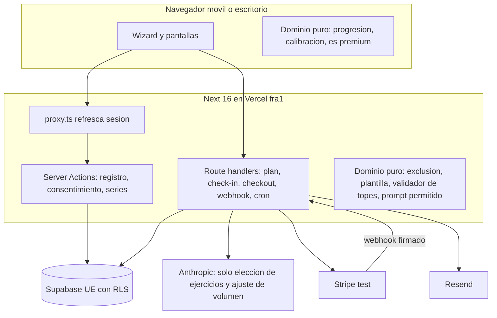
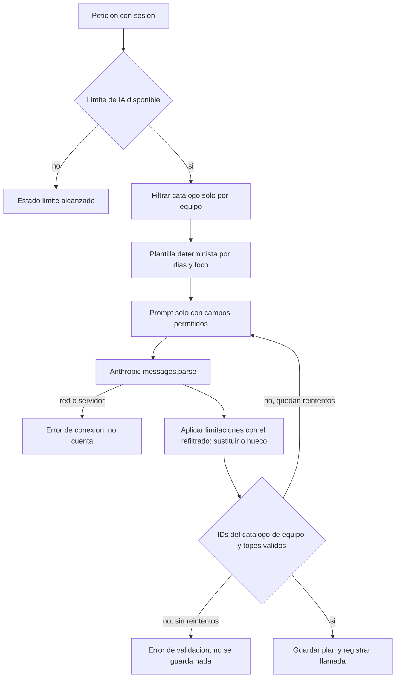
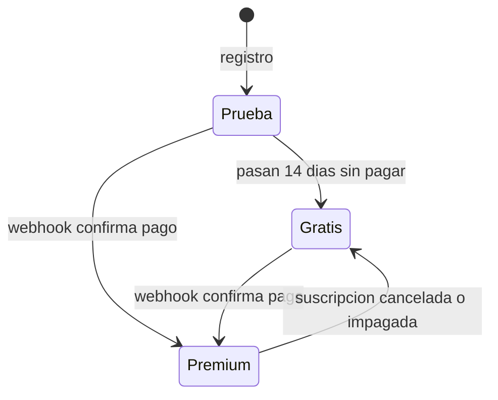

# BUDDY demo completa - Plan

---

## Goal Capsule

- **Objective:** el viernes 20/11/2026 Pablo y las personas que añada al equipo del proyecto de Supabase pueden, en producción (https://buddy-xi-eight.vercel.app), pasar el wizard con cribado, recibir su plan, calibrar, entrenar cada día con la carga que toca, hacer el check-in semanal con el coach, pagar premium en modo test, y Pablo recibe los emails (D7, D34), sin que se incumpla ningún guardarraíl de salud o RGPD de `CLAUDE.md`.
- **Means:** Next 16 + Supabase (Auth, Postgres con RLS) + funciones de dominio puras con Vitest + Anthropic solo en servidor, construido en el orden de la §20 del PRD con su línea de corte (KTD1–KTD20).
- **Referencias:** "Dn" a secas es una decisión de `docs/01`; "diseño Dn" o "Dn de diseño" es una decisión de `docs/diseno/sistema-de-diseno.md` §11 (numeraciones distintas).
- **Autoridad, de mayor a menor:** `CLAUDE.md` (guardarraíles) > `docs/02-prd-v1.md` (PRD v1.1) y decisiones de `docs/01` (D1–D43) > `DESIGN.md` y `docs/diseno/sistema-de-diseno.md` §11 (D3–D31 de diseño) > este plan. Si el código y el PRD se contradicen, se para y se pregunta a Pablo.
- **Perfil de ejecución:** 4 sesiones de 5 h (S1–S4) hasta el 20/11. Claude Code construye; Pablo valida el modelo de datos (U2), prueba cada PR en staging y decide. Ramas `feature/<tarea>` → PR a `staging` → PR a `main`.
- **Paradas obligatorias:** contradicción código/PRD; un guardarraíl que no se puede cumplir; una clave que falta al empezar su unidad (U5 Anthropic, U9 Stripe, U10 Resend); cualquier cambio en la BBDD de prod fuera de migraciones.
- **Quién termina:** Pablo hace el merge a `main` y graba el Loom (fase 5). Lo que quede bajo la línea de corte (U13–U20) solo entra si sobra tiempo, en su orden.

---

## Product Contract

### Summary

El plan construye la "demo completa" de la §20 del PRD (pasos 1 a 6) en 12 unidades repartidas en 4 sesiones, con el diseño cerrado en `DESIGN.md`, y deja esbozadas en su orden las 8 piezas que van tras la línea de corte. La lógica que toca la salud y las cargas vive en funciones puras con tests; la IA solo elige ejercicios y ajusta volumen dentro de topes validados en código.

### Problem Frame

BUDDY tiene producto (PRD v1.1), revisión CEO, diseño y decisiones cerradas, pero el repo solo tiene el esqueleto de Next 16 con un botón de shadcn: sin migraciones, sin cliente de Supabase, sin IA ni pagos. La entrega se movió al 20/11 (D38) y el tiempo bajó a 4 sesiones de 5 h, sin recortar alcance. El riesgo no es técnico sino de tiempo y de cumplimiento: los guardarraíles (cribado, exclusión por articulaciones, nada de salud en prompts ni analítica, RLS, la IA nunca toca cargas) tienen que salir bien a la primera porque no habrá margen para rehacerlos.

### Requirements

**Onboarding y seguridad**
- R1. Wizard completo de PRD §5 con las pantallas y estados de `DESIGN.md` y sistema §11.12; ninguna respuesta preseleccionada (diseño D6 y D13).
- R2. Registro 18+ con confirmación por email (D34); las respuestas previas al registro se guardan en la cuenta al registrarse, aunque el enlace se abra en otro navegador (PRD §5, pendiente de verificar).
- R3. Consentimiento explícito antes de cualquier dato de salud, con salida clara (PRD §5.7, D14).
- R4. Cribado de PRD §13: cualquier "sí" bloquea la generación, salvo la pregunta articular, que obliga a marcar la zona en limitaciones.
- R5. Limitaciones por etiquetas de articulación; la exclusión es determinista y ningún plan puede incluir un ejercicio que cargue una zona limitada (guardarraíl 6).

**Plan**
- R6. Generación del plan: plantilla determinista por días (PRD §7) y la IA elige ejercicios del catálogo cerrado filtrado solo por equipo, con las limitaciones aplicadas después en código (KTD19, KTD20); salida validada con zod y con el validador único de topes; reintento y error claro (guardarraíles 2–4, D9 de diseño).
- R7. Refiltrado determinista y gratis al cambiar limitaciones o equipo, con hueco vacío explicado y con acciones (D35, D28 de diseño).
- R8. Cambio de foco o días: gratis 1 al mes; premium sin ese límite mensual, dentro de sus 5 regeneraciones al mes (D43 y Key Decisions); siempre regenerando con IA.
- R9. Catálogo semilla de 25–35 tipos de equipo y sus ejercicios, con equipo, patrón, región, grupos, articulaciones, carga de calibración y salto de máquina (PRD §6, D27 de diseño).

**Sesión y progresión**
- R10. Calibración de PRD §8 con la carga inicial de D27 de diseño.
- R11. Sesión del día de PRD §9 con las decisiones de diseño D7, D8, D12, D16, D18, D22, D23 y D29.
- R12. Doble progresión de PRD §10 en funciones puras compartidas por servidor y cliente; Molestia para el ejercicio hoy sin subida (guardarraíl 7).
- R13. Cada serie y sesión llevan un ID generado en el cliente con restricción única (D28); en la demo se guardan directamente (sin cola local).

**Premium, prueba y pago**
- R14. Coach que explica (check-in semanal, PRD §11.1) con la aparición y estados de diseño D10 y la decisión del usuario de D41.
- R15. Prueba de 14 días desde el registro y una única función "es premium" con el reloj de la prueba y `subscription_status` (D36), con los avisos de D30 de diseño.
- R16. Stripe test: Checkout mensual, webhook que actualiza `subscription_status`, vuelta con los 4 estados de diseño D11.
- R17. Límites de IA por función (ver Key Decisions) y registro de cada llamada con tipo, tokens, coste y resultado, sin contenido (guardarraíl 12).

**Emails**
- R18. Tres emails de Resend (bienvenida, confirmación de compra, inactividad >14 días por cron diario) con las reglas de `DESIGN.md` §9, y una fila de resultado por cada envío del cron (gap crítico de la revisión CEO).

**Privacidad y seguridad**
- R19. RLS en todas las tablas; nadie puede leer datos de otro ni hacerse admin o premium por su cuenta.
- R20. Ningún dato de salud en prompts (lista cerrada de campos con test, D29), en analítica, en logs ni en mensajes de error; Molestia y bloqueos del cribado solo como contador diario sin `user_id` (D30).
- R21. Las claves de servidor nunca llegan al cliente; las de Supabase son las nuevas (D26).

**Plataforma y experiencia**
- R22. UI en español según `DESIGN.md`: navegación (diseño D3), escritorio (diseño D24), regla de alto de 360×640 (diseño D22), accesibilidad (diseño D25), temas claro y oscuro.
- R23. Ajustes con los 4 bloques de D15 de diseño, incluidos retirar el consentimiento y borrar la cuenta.

### Key Decisions

- **Entrega el viernes 20/11/2026 en 4 sesiones de 5 h, sin recortar alcance.** (session-settled: user-directed — chosen over the original 6 sessions and over cutting scope: Pablo fixed the date and the time available.) Governs R1–R23 sequencing.
- **Límites de IA por función.** Gratis: plan inicial + 1 cambio de foco o días al mes. Premium: 5 regeneraciones al mes, 1 check-in por semana, 30 mensajes al mes en Pregúntale a BUDDY. Los intentos que fallan la validación no cuentan, con un tope técnico de 20 llamadas al día por usuario. (session-settled: user-approved — chosen over one global monthly cap and over a more generous allowance: protects cost without hurting normal use.) Governs R8, R17.
- **Escritorio con diseño propio (menú lateral y columnas desde 1024 px).** (session-settled: user-directed — chosen over a centered mobile column: Pablo wants the larger screen used.) Governs R22.
- **Un usuario gratis puede cambiar foco o días una vez al mes (D43).** (session-settled: user-approved — chosen over premium-only and over a rules-only rebuild: changing days must not trap free users.) Governs R8.
- **La IA nunca ve nada de lo que se pueda deducir la salud (D44).** (session-settled: user-directed — chosen over the PRD §7/§11 wording with a limitation-filtered catalog and discomfort IDs: the filtered catalog reveals the limitation.) Governs R6, R14, R20.
- **El mínimo semanal solo para grupos con algún ejercicio posible (D45).** (session-settled: user-directed — chosen over blocking plan generation: the user must always get a plan.) Governs R5, R6.
- **La demo la usan Pablo y el equipo de Supabase; solo Pablo recibe emails (D7, D34).** (session-settled: user-directed — chosen over buying a domain before 20/11: the domain stays in TODOS.md.) Governs R2, R18.
- **Sin tests de navegador automatizados; la UI se comprueba a mano en staging con capturas.** (session-settled: user-approved — chosen over a Playwright E2E suite: no time in 20 h.) Governs the Verification Contract.

### Scope Boundaries

- Fase 2 del PRD y `TODOS.md`: multi-gimnasio (el esquema lo permite, no se construye), nutrición, wearables, foto de máquina (D27), PWA offline, edición libre del plan, dominio propio, bloqueantes legales.
- No se activa la integración Supabase ↔ GitHub "Deploy to production".
- Considerado y no construido: cola local con service worker (PRD fase 2); motor genérico de sincronización (revisión CEO §5); caché de datos de usuario con `'use cache'` (sus claves se guardan en claro, KTD1).

#### Deferred to Follow-Up Work

Tras la línea de corte, en este orden (PRD §20) y solo si sobra tiempo: U13 panel de admin, U14 cola local, U15 estancamiento, U16 semana adaptada, U17 registro de actividades, U18 gráficas completas, U19 sesión exprés, U20 Pregúntale a BUDDY.

Nuevo en `TODOS.md` al cerrar el plan: Vercel Hobby es solo para uso personal no comercial; cobrar a usuarios reales exige Vercel Pro (bloqueante de producción, junto a dominio propio y temas legales).

### Dependencies

- Claves de Pablo: Anthropic (antes de U5), Stripe test (antes de U9), Resend y `CRON_SECRET` (antes de U10). Guía en la conversación del 12/11.
- Pablo valida el modelo de datos de la sección "Modelo de datos" antes de la primera migración (U2).
- La confirmación por email de Supabase sin SMTP propio solo llega a miembros del equipo del proyecto y con un máximo de unos 2 emails por hora: los testers se añaden al equipo de Supabase (D34).

---

## Planning Contract

### Key Technical Decisions

- KTD1. **Cache Components desactivado.** El esqueleto tiene `cacheComponents: true` y `partialPrefetching` en `next.config.ts`; con ellos, toda lectura de cookies o de Supabase debe ir dentro de `<Suspense>` y las rutas no pueden declarar `runtime`/`dynamic`, lo que rompe los ejemplos oficiales de Supabase y Stripe. Casi todo BUDDY es por usuario y dinámico, así que se apagan los dos flags y nunca se usa `'use cache'` con datos de usuario (sus claves se guardan en claro). Alternativa descartada: mantenerlo y envolver cada lectura, más fricción en 20 h sin ganancia.
- KTD2. **Supabase con `@supabase/ssr` y `src/proxy.ts`.** En Next 16 el middleware se llama `proxy` y corre en Node; refresca la sesión con `getClaims()` (nunca `getSession()` en servidor) y devuelve el mismo objeto de respuesta. El matcher excluye `/api/stripe/webhook` y `/api/cron/*`. Tres clientes: navegador (clave publicable), servidor con cookies (clave publicable + sesión del usuario, sujeto a RLS) y admin con la clave secreta, solo en `src/lib/supabase/admin.ts` marcado `server-only`, usado por webhook, cron, registro de IA y contadores, y para escribir las tablas que el usuario solo puede leer: `onboarding_answers` en el registro (con el `user.id` de `signUp`), `health_profile`, `plans`/`plan_sessions`/`plan_slots`, `checkins` y `events`. Esas escrituras ocurren siempre después de la comprobación de KTD15 (o de la excepción del registro), y las de `health_profile` comprueban en código el consentimiento vigente, porque el cliente admin salta la RLS.
- KTD3. **Estado de cuenta en una tabla sin UPDATE para el usuario.** `account_status` guarda `role`, `subscription_status`, `trial_ends_at` e IDs de Stripe; el usuario solo puede leer su fila, y escribe únicamente el servidor con el cliente admin. Así nadie se hace admin ni premium (revisión CEO §3).
- KTD4. **Registro por Server Action que guarda en el servidor las respuestas previas.** La acción recibe email, contraseña, +18 y las respuestas del wizard sin datos de salud (foco, experiencia, disponibilidad, deportes, gimnasio), validadas con zod, y las guarda con el nuevo `user.id`. La confirmación usa `/auth/confirm` con `token_hash` + `verifyOtp`, que funciona en cualquier navegador. Resuelve el riesgo de perder respuestas (R2). El `user.id` sale de la respuesta de `signUp` y el guardado es solo inserción, así que nunca sobrescribe una cuenta existente. `/auth/confirm` acepta solo los `type` esperados y un `next` relativo que empieza por una única `/` (rechaza `//` y `\`), y sus errores son genéricos, sin el mensaje de Supabase en la URL. Los datos de salud se piden después del consentimiento, ya con sesión.
- KTD5. **Dominio en funciones puras.** `src/lib/domain/` contiene sin dependencias de red: exclusión por articulaciones, cribado, plantilla por días, validador único de topes, refiltrado y alternativas, carga de calibración, paso de calibración, doble progresión, "es premium", límites de IA y la lista de campos permitidos en prompts. Las usan servidor y cliente (D28) y tienen sus tests al lado.
- KTD6. **IA con `messages.parse` y salida zod.** `@anthropic-ai/sdk` con `zodOutputFormat`; el esquema usa un enum fijo con todos los IDs del catálogo (un esquema estable, sin recompilar por usuario) y la IA recibe solo el catálogo filtrado por equipo (nunca por limitaciones, para que no se pueda deducir ninguna). Después, el código aplica la exclusión por limitaciones con el refiltrado determinista (sustituye por una alternativa o deja hueco con motivo) y pasa el resultado por el validador de topes (KTD19). Hasta 2 reintentos; luego, error de validación (D9 de diseño). Sin `tool_choice` forzado, sin temperatura personalizada ni prefill (dan 400 en Sonnet 5.5). Los topes nunca se confían al esquema JSON (la API descarta mínimos y máximos).
- KTD7. **Modelo por defecto Sonnet 5.5, medido contra Haiku 5.5.** `claude-sonnet-5-5` para plan y check-in; en U5 se pasan 10 perfiles fijos de wizard por los dos modelos y se elige por tasa de validación y coste (PRD §18). Precios: Sonnet 2 $/10 $ y Haiku 0,10 $/0,50 $ por millón de tokens de entrada/salida.
- KTD8. **Stripe sin trial de Stripe.** La prueba de 14 días la calcula la app desde el registro (D36); Stripe solo cobra la suscripción mensual. El webhook verifica la firma con el cuerpo crudo, guarda cada `event.id` en `stripe_events` con clave única (los duplicados se ignoran) y vuelve a pedir la suscripción a Stripe para guardar su estado actual (los eventos llegan desordenados). El `event.id` y el cambio de `account_status` se guardan en una sola llamada a la función de base de datos de KTD16 (una transacción), para que un fallo deje reintentar a Stripe. El checkout fija el precio y el cliente en el servidor (el cliente de Stripe se guarda en `account_status`), los eventos de clientes desconocidos se ignoran (staging y prod comparten la cuenta de test) y solo `active` y `trialing` cuentan como premium. La pantalla de vuelta consulta `account_status`; nunca activa premium por el `session_id` de la URL.
- KTD9. **Cron de inactividad idempotente.** Vercel Hobby: un cron diario, solo en producción y con ±59 min. Cada envío deja una fila en `email_log` con resultado; la restricción única por usuario y periodo de inactividad impide un segundo envío si el cron corre dos veces. En staging se lanza a mano con `CRON_SECRET` y el bypass de Vercel. `CRON_SECRET` es obligatoria en `env.ts` y se compara en tiempo constante; sin ella, la ruta falla cerrada.
- KTD10. **Región de funciones en la UE.** `vercel.json` fija `fra1`, junto a Supabase UE. Las funciones de IA declaran `maxDuration` como tope (Hobby admite hasta 300 s).
- KTD11. **Guardado directo de series con IDs del cliente.** Cada serie se envía al hacerla con su UUID; la tabla tiene restricción única, así que un doble toque o un reintento no duplica (D28). La cola local (U14) solo añadirá el reenvío.
- KTD12. **Tests sin Docker.** No hay Docker, así que no hay Supabase local. Unitarios con Vitest para todo el dominio y la ruta del webhook (firma generada con la utilidad de test de Stripe); RLS con una suite de integración de Vitest contra staging, con dos usuarios de prueba, que solo corre con una variable de entorno explícita.
- KTD13. **Tema según `DESIGN.md`.** Tokens en las variables de shadcn de `src/app/globals.css`; fuentes con `next/font`: Archivo con eje `wdth`, `Atkinson_Hyperlegible_Next` y `Press_Start_2P` (peso 400).
- KTD19. **La IA no ve nada de lo que se pueda deducir la salud.** El prompt del plan y del check-in lleva solo el catálogo filtrado por equipo, el foco, la disponibilidad, los deportes, las escalas y las actividades; nunca limitaciones, cribado, molestias ni un catálogo recortado por limitaciones. Las limitaciones y molestias se aplican después, en código, con el refiltrado. (session-settled: user-directed — chosen over the PRD §7/§11 wording (catalog pre-filtered by limitations, discomfort IDs in the check-in): a filtered catalog lets the provider infer the limitation, which breaks guardrail 8 / D29.)
- KTD20. **El mínimo semanal solo se exige a grupos con algún ejercicio posible.** El validador de topes aplica "cada grupo principal al menos 2 veces por semana" solo a los grupos que tienen al menos un ejercicio válido con el equipo y las limitaciones del usuario; un grupo sin ninguno queda como hueco con motivo, en la generación y en el refiltrado. Prima la limitación (guardarraíl 6) y el usuario siempre tiene plan. (session-settled: user-directed — chosen over blocking plan generation: an unsatisfiable floor would leave the user without a plan.)
- KTD14. **Analítica y contadores sin salud.** `events` solo admite una lista cerrada de nombres de evento sin contenido de salud; no hay evento para la pantalla de bloqueo ni para el resultado del cribado, y el embudo marca el cribado como un único paso "seguridad" (D30). `daily_counters` (día, métrica, total, sin `user_id`) se incrementa solo con una función `SECURITY DEFINER` que llama el servidor.
- KTD15. **Frontera de autorización en cada entrada.** Cada Server Action y route handler llama a `getClaims()` dentro de su propio código y toma el `user_id` solo de los claims; el proxy y las páginas no protegen las Server Actions. Las comprobaciones de premium y de límites también se hacen en el servidor. Única excepción: la acción de registro, que no tiene sesión (la confirmación por email está activa); toma el `user_id` solo de la respuesta de `signUp`, nunca de la entrada, inserta sin sobrescribir y, si el email ya existía (Supabase puede devolver un usuario ofuscado), responde lo mismo que en un registro correcto ("revisa tu email"). Ver "System-Wide Impact".
- KTD16. **Cliente admin acotado.** Las funciones que usan la clave secreta nunca reciben un `user_id` de la entrada. Las funciones `SECURITY DEFINER` viven en un esquema `private`, fijan `search_path` vacío y revocan `EXECUTE` a `PUBLIC`, `anon` y `authenticated`. Como la API de Supabase solo expone `public`, cada función que llama el servidor (incremento de contadores, reserva del límite de IA, aplicar un evento de Stripe) tiene un envoltorio fino en `public` que solo puede ejecutar `service_role`.
- KTD17. **Registro seguro de errores.** Un único helper de log escribe solo códigos (de Postgres, de zod y propios), nunca `detail`, valores de entrada ni mensajes de error crudos; `ai_calls.outcome` y `email_log.status` son enums. Ninguna ruta ni query string lleva datos de salud.
- KTD18. **Reserva atómica del límite de IA.** Antes de llamar a Anthropic se reserva el intento con una función de base de datos (o una fila pendiente en `ai_calls`), para que peticiones en paralelo no pasen todas el límite; el tope técnico de 20 al día cuenta cada intento, también reintentos y fallos. Una reserva solo consume el límite mensual o semanal cuando se confirma con resultado `ok`; una reserva pendiente más antigua que el `maxDuration` de la función se considera liberada (aunque sigue contando para el tope diario).

### Modelo de datos

Pablo lo valida antes de la primera migración (U2). Todas las tablas con RLS; "propia" significa que el usuario solo ve y escribe sus filas. Todas las claves foráneas a `auth.users` llevan `on delete cascade`, también `events` y `ai_calls`.

| Tabla | Contenido | Acceso del usuario |
|---|---|---|
| `account_status` | `user_id`, `role`, `subscription_status`, `trial_ends_at`, IDs de Stripe | Solo lectura de la suya (KTD3) |
| `user_settings` | tema, mostrar descanso | Propia |
| `onboarding_answers` | foco, experiencia, días, minutos, deportes (sin salud) | Propia |
| `consents` | versión, `granted_at`, `withdrawn_at` | Propia (insertar y retirar) |
| `health_profile` | limitaciones (etiquetas), resultado del cribado y versión; nunca las respuestas una a una | Solo lectura de la suya (sin políticas de INSERT ni UPDATE); escribe una Server Action con el cliente admin tras comprobar el consentimiento vigente; se borra al retirar el consentimiento |
| `gym_profiles` | preset y tipos de equipo marcados (tabla propia para multi-gimnasio futuro) | Propia |
| `equipment_types`, `exercises`, `activity_types` | catálogo: zona, salto de máquina, mínimo, patrón, región, grupos, articulaciones, carga de calibración | Lectura para autenticados |
| `plans`, `plan_sessions`, `plan_slots` | plan versionado; el hueco tiene `exercise_id` nulo y un código de motivo cerrado sin articulación (`sin_alternativa_limitacion` o `sin_alternativa_equipo`); el texto con la zona se compone al mostrarlo, desde `health_profile` | Lectura propia; escribe el servidor |
| `workout_sessions` | ID del cliente, tipo (calibración o normal), inicio y fin | Propia |
| `set_logs` | ID del cliente (único), ejercicio, peso, repeticiones, RIR de calibración, hecho o saltado; índice por usuario, ejercicio y fecha; clave foránea compuesta `(user_id, session_id)` | Propia: inserción idempotente (sin upsert que fusione), y actualizar peso, repeticiones y estado, o borrar, solo sus propias filas para Editar y Deshacer (diseño D8); `user_id` y `session_id` inmutables |
| `exercise_state` | carga de trabajo, salto propio, calibrado | Propia |
| `discomfort_marks` | ejercicio y sesión marcados con Molestia (para detectar la repetición); dato de salud | Propia; se borra al retirar el consentimiento |
| `checkins` | semana, escalas, ajuste validado, aplicado o no; único por usuario y semana | Solo lectura de la suya; escribe el servidor (el ajuste nunca lo escribe el usuario) |
| `ai_calls` | tipo, modelo, tokens, coste, resultado; sin prompt ni respuesta | Escribe el servidor; lectura admin |
| `events` | evento de producto sin salud | Inserta el servidor; lectura admin |
| `daily_counters` | día, métrica, total; sin `user_id` | Ninguno (KTD14) |
| `stripe_events` | `event_id` único | Ninguno |
| `email_log` | tipo, periodo, resultado, error; único por usuario, tipo y periodo | Ninguno |

### High-Level Technical Design

Arquitectura y fronteras:

Generación del plan (también el check-in, con su propio esquema):

Estado premium (una sola función, D36):

### System-Wide Impact

| Entrada | Comprobación obligatoria |
|---|---|
| Registro (sin sesión) | `user_id` solo de la respuesta de `signUp`; zod de la entrada; inserción sin sobrescribir; respuesta idéntica si el email ya existe (KTD15) |
| Server Actions (consentimiento, limitaciones, cribado, series, Molestia, refiltrado, ajustes) | `getClaims()` en la acción; `user_id` solo de los claims; zod de la entrada |
| `/api/plan`, `/api/checkin` | Sesión; consentimiento vigente; cribado superado leído en el servidor; premium (check-in); reserva de límite (KTD18) |
| `/api/stripe/checkout` | Sesión; precio y cliente fijados en el servidor |
| `/api/stripe/webhook` | Firma de Stripe sobre el cuerpo crudo |
| `/api/cron/inactividad` | `CRON_SECRET` en tiempo constante |
| `/auth/confirm` | Lista de `type` permitidos y `next` relativo (KTD4) |

Datos de salud: `health_profile` y `discomfort_marks`. Se escriben solo con consentimiento vigente, se borran al retirarlo, nunca van a `events`, logs, errores, URLs ni prompts .

### Sequencing

| Sesión | Unidades | Hito comprobable en staging |
|---|---|---|
| S1 | U1, U2, U3, U4 | Registro con confirmación, consentimiento, limitaciones y cribado con bloqueo; tests del dominio en verde |
| S2 | U5, U6 | Plan generado por IA, pestaña Plan, Hoy, navegación móvil y escritorio, refiltrado |
| S3 | U7, U8 | Calibración y sesión completa con progresión; check-in del coach |
| S4 | U9, U10, U11, U12 | Pago test, emails y cron, Ajustes; merge a `main` y migraciones en prod |

Si una sesión se retrasa, la unidad siguiente empieza igualmente en su orden y lo que no quepa cae por el final (U12 se reduce a desplegar), nunca saltándose un guardarraíl.

### Assumptions

- Unas 5 h efectivas por sesión; el plan no tiene holgura.
- El catálogo semilla lo compone Claude a partir de los tipos de equipo comunes y el gimnasio de Pablo; Pablo lo revisa en el PR de U2.
- La redacción del cribado se usa como está en el prototipo hasta cotejarla con el PAR-Q+ 2023 (riesgo aceptado, PRD §13).

---

## Implementation Units

| U-ID | Título | Archivos principales | Depende de |
|---|---|---|---|
| U1 | Base: dependencias, tema, proxy y clientes de Supabase | `next.config.ts`, `src/app/globals.css`, `src/app/layout.tsx`, `src/proxy.ts`, `src/lib/supabase/*` | — |
| U2 | Esquema, RLS y catálogo semilla | `supabase/migrations/*`, `src/lib/supabase/types.ts` | U1 |
| U3 | Dominio puro y sus tests | `src/lib/domain/*` | U1 |
| U4 | Wizard, registro, consentimiento, limitaciones y cribado | `src/app/(wizard)/*`, `src/app/auth/confirm/route.ts` | U2, U3 |
| U5 | Generación del plan con IA, límites y registro de llamadas | `src/lib/ai/*`, `src/app/api/plan/route.ts` | U2, U3, U4 |
| U6 | Estructura de la app, Hoy, pestaña Plan y refiltrado | `src/app/(app)/*`, `src/components/nav/*` | U5 |
| U7 | Calibración, sesión del día, Molestia y fin de sesión | `src/app/(app)/sesion/*`, `src/app/actions/sets.ts` | U3, U6 |
| U8 | Coach que explica (check-in) | `src/app/(app)/checkin/*`, `src/app/api/checkin/route.ts` | U5, U7 |
| U9 | Stripe: checkout, webhook y prueba de 14 días | `src/app/api/stripe/*`, `src/app/(app)/premium/*` | U2, U3 |
| U10 | Emails de Resend y cron de inactividad | `src/lib/email/*`, `src/app/api/cron/inactividad/route.ts`, `vercel.json` | U2, U9 |
| U11 | Ajustes, retirar consentimiento y borrar cuenta | `src/app/(app)/ajustes/*` | U6 |
| U12 | Cierre: accesibilidad, comprobaciones y paso a producción | varios | U1–U11 |
| U13–U20 | Tras la línea de corte (esbozo) | — | U12 |

### U1. Base: dependencias, tema, proxy y clientes de Supabase

- **Goal:** dejar el proyecto listo para construir pantallas con la marca y con sesión de Supabase.
- **Requirements:** R21, R22; KTD1, KTD2, KTD10, KTD13.
- **Dependencies:** ninguna.
- **Files:** `package.json`, `next.config.ts`, `vitest.config.mts`, `vercel.json`, `src/app/globals.css`, `src/app/layout.tsx`, `src/proxy.ts`, `src/lib/supabase/client.ts`, `src/lib/supabase/server.ts`, `src/lib/supabase/admin.ts`, `src/lib/env.ts`, `src/lib/env.test.ts`, `.env.example`.
- **Approach:**
  1. Instalar `@supabase/supabase-js`, `@supabase/ssr`, `zod` (v4) y `server-only`; las de IA, Stripe y Resend se instalan en sus unidades. En `vitest.config.mts`, alias de `server-only` a un módulo vacío para poder probar los módulos de servidor.
  2. Apagar `cacheComponents` y `partialPrefetching` (KTD1); `vercel.json` con región `fra1`.
  3. Tokens de `DESIGN.md` §2 en las variables de shadcn, superficies del navegador (§8) y fuentes (KTD13).
  4. `src/lib/env.ts` valida con zod las variables de entorno y separa las públicas de las de servidor; las de servidor solo se importan desde módulos `server-only`.
  5. `src/proxy.ts` y los tres clientes según KTD2.
- **Patterns to follow:** guías locales `node_modules/next/dist/docs/` (proxy, route handlers, fonts); `AGENTS.md`.
- **Test scenarios:**
  - `env`: con todas las variables, devuelve el objeto tipado; sin `SUPABASE_SECRET_KEY` falla con un error que nombra la variable y no muestra ningún valor.
  - `env`: una variable de servidor no aparece en el objeto público.
  - Importar `src/lib/supabase/admin.ts` bajo Vitest no lanza error.
- **Verification:** `npm run build` en verde; la página de inicio muestra la tipografía y colores de `DESIGN.md` en claro y oscuro; `/api/stripe/webhook` no redirige a login.

### U2. Esquema, RLS y catálogo semilla

- **Goal:** crear en staging el modelo de datos validado, con RLS y el catálogo cerrado.
- **Requirements:** R5, R9, R13, R19, R20; KTD3, KTD11, KTD14.
- **Dependencies:** U1.
- **Files:** `supabase/migrations/<timestamp>_esquema_inicial.sql`, `supabase/migrations/<timestamp>_catalogo_semilla.sql`, `src/lib/supabase/types.ts`, `src/lib/supabase/rls.integration.test.ts`.
- **Approach:**
  1. Tablas, restricciones únicas e índices del "Modelo de datos"; trigger que crea `account_status` (trial de 14 días) y `user_settings` al registrarse.
  2. Políticas RLS por tabla según la columna "Acceso"; función `SECURITY DEFINER` para `daily_counters` sin permiso para `authenticated`.
  3. Catálogo semilla como migración (25–35 tipos de equipo, ejercicios con articulaciones y carga de calibración).
  4. Aplicar en staging con la CLI, comprobando antes el ref vinculado (`jrzicjoyraqhwioeinwa`); generar tipos.
- **Execution note:** antes de escribir la migración, enseñar a Pablo la tabla del modelo y esperar su visto bueno (docs/03, fase 3).
- **Test scenarios:**
  - El usuario A no lee filas de B en `set_logs`, `health_profile` ni `checkins`.
  - El usuario A no puede actualizar su `account_status` (ni `role` ni `subscription_status`).
  - El usuario A no puede insertar en `daily_counters`, `ai_calls`, `stripe_events` ni `email_log`.
  - Insertar dos veces un `set_logs` con el mismo ID deja una sola fila.
  - Un usuario autenticado lee el catálogo; un anónimo no.
  - El usuario A no puede escribir `health_profile` directamente, ni marcar el cribado como superado, ni guardar limitaciones sin consentimiento vigente.
  - El usuario A no puede insertar ni actualizar filas de `checkins`.
  - El usuario A no puede añadir una serie a una sesión de B, ni actualizar o borrar series de B.
  - El rol `authenticated` no puede ejecutar los envoltorios de `public` de KTD16.
  - Las funciones `SECURITY DEFINER` no son ejecutables por `anon` ni `authenticated`.
- **Verification:** la suite de RLS pasa contra staging; `npx supabase migration list` muestra las migraciones aplicadas en staging y no en prod.

### U3. Dominio puro y sus tests

- **Goal:** tener en funciones puras y probadas todas las reglas que no pueden fallar.
- **Requirements:** R4, R5, R6, R7, R8, R10, R12, R15, R17, R20; KTD5.
- **Dependencies:** U1.
- **Files:** `src/lib/domain/screening.ts`, `exclusion.ts`, `template.ts`, `volume.ts`, `refilter.ts`, `calibration.ts`, `progression.ts`, `premium.ts`, `ai-limits.ts`, `prompt-fields.ts`, `src/lib/log.ts` y un `.test.ts` junto a cada uno.
- **Approach:** cada módulo recibe datos planos (catálogo, respuestas, historial) y devuelve un resultado; ninguno lee la red ni la hora del sistema (la hora entra como parámetro).
- **Execution note:** escribir cada módulo test-first; es el sitio donde un error no se ve en la pantalla.
- **Test scenarios:**
  - Cribado: todo "No" pasa; un "Sí" de riesgo bloquea; "Sí" articular sin zona marcada exige zona; embarazo "Sí" bloquea.
  - Exclusión: "rodilla" excluye prensa y sentadilla; "Ninguna" no excluye nada; dos zonas excluyen la unión.
  - Plantilla: 2 o 3 días dan cuerpo completo; 4 o 5 días dan torso y pierna alternos.
  - Validador de topes: un plan válido pasa; 21 series de un grupo en la semana se rechazan; un grupo principal con ejercicios posibles 1 vez por semana se rechaza; un ejercicio con 1 serie se rechaza.
  - Grupo sin ejercicios posibles (rodilla limitada sin alternativa de pierna con el equipo): el plan valida con hueco y motivo, sin volver a llamar a la IA (KTD20).
  - Prompt sin inferencia: el prompt de un perfil con limitaciones es idéntico, byte a byte, al del mismo perfil sin limitaciones (KTD19).
  - Refiltrado: añadir "rodilla" sustituye la sentadilla por una alternativa del mismo patrón y grupo; si no hay alternativa con el equipo, deja hueco con motivo.
  - Calibración (carga inicial): "Nunca he entrenado" resta un salto; "Más de 2 años" suma uno; nunca baja del mínimo de la máquina.
  - Calibración (paso): 4+ sube un salto; 0–1 o no llega baja uno; 2–3 fija; la tercera serie fija aunque no se cumpla.
  - Doble progresión: todas las series en el techo dos sesiones seguidas suben un salto y vuelven al suelo del rango; una sola sesión en el techo no sube; no llegar al suelo repite carga; fallar dos sesiones seguidas baja un salto; las saltadas no cuentan; una Molestia hoy no sube.
  - Es premium: dentro de los 14 días es premium; el día 15 sin pago no lo es; con `subscription_status` activo lo es aunque la prueba haya terminado.
  - Límites de IA: gratis con el cambio del mes usado no puede regenerar; premium con 5 regeneraciones en el mes no puede; un intento fallido por validación no cuenta; la llamada 21 del día se rechaza.
  - Campos permitidos: el prompt construido nunca contiene limitaciones, cribado, Molestia en texto, email ni nombre; añadir un campo no permitido hace fallar el test.
  - Log seguro: un error de Postgres con `detail` que contiene una etiqueta de articulación se registra solo con su código (KTD17).
- **Verification:** `npm test` en verde con todos los escenarios.

### U4. Wizard, registro, consentimiento, limitaciones y cribado

- **Goal:** que una persona nueva llegue de la bienvenida al resumen con cuenta, consentimiento y cribado superado, o al bloqueo.
- **Requirements:** R1–R5, R20, R22; KTD4, KTD14.
- **Dependencies:** U2, U3.
- **Files:** `src/app/(wizard)/` (una ruta por pantalla de sistema §11.12), `src/app/(wizard)/actions.ts`, `src/app/auth/confirm/route.ts`, `src/components/wizard/*`, `src/lib/wizard/draft.ts`, `src/lib/wizard/draft.test.ts`, `src/app/(wizard)/actions.test.ts`.
- **Approach:**
  1. Pantallas y textos según sistema §11.12, §11.4 (cribado sin respuesta por defecto, diseño D6) y §11.13 (salida sin consentimiento).
  2. Borrador en el dispositivo (sin salud) hasta el registro; el registro lo envía al servidor (KTD4).
  3. Consentimiento, limitaciones y cribado se guardan solo con sesión y consentimiento vigente; del cribado se guarda el resultado, no las respuestas.
  4. Un bloqueo del cribado suma al contador diario (KTD14) y no deja rastro con `user_id`.
  5. Eventos de embudo por pantalla sin contenido de salud (KTD14).
  6. Configurar Supabase Auth de staging en el panel: plantilla "Confirm signup" con el enlace `/auth/confirm?token_hash=…&type=email`, Site URL de staging, staging y localhost en Redirect URLs y "Confirm email" activado.
  7. Accesibilidad según diseño D25 al construir: zonas con nombre, avisos `role="status"`/`role="alert"` y nombres completos en los controles.
- **Test scenarios:**
  - El registro sin la casilla +18 se rechaza con error en línea.
  - El registro guarda las respuestas previas con el nuevo usuario.
  - Confirmar el email en otro navegador deja la cuenta con sus respuestas (prueba manual en staging).
  - Guardar limitaciones sin consentimiento vigente se rechaza.
  - Un "Sí" de riesgo lleva al bloqueo, incrementa el contador diario y no escribe `health_profile` ni ningún evento con `user_id`.
  - Los eventos del wizard solo usan nombres de la lista cerrada; no existe evento de bloqueo ni de resultado del cribado.
  - Cada Server Action del wizard, salvo el registro, llamada sin sesión se rechaza.
  - Registrarse con un email que ya existe devuelve la misma respuesta que un registro nuevo y no sobrescribe nada.
  - `/auth/confirm` con `next=//evil.com` o `next=https://evil.com` redirige a una ruta interna; un `type` no permitido se rechaza; el error no lleva el mensaje de Supabase.
- **Verification:** en staging, un registro completo de Pablo llega a "Todo listo"; con un "Sí" de riesgo llega al bloqueo; el email de confirmación llega.

### U5. Generación del plan con IA, límites y registro de llamadas

- **Goal:** generar un plan válido, guardarlo y mostrarlo, con sus estados de carga, error y límite.
- **Requirements:** R6, R8, R17, R20; KTD6, KTD7, KTD10.
- **Dependencies:** U2, U3, U4. Necesita `ANTHROPIC_API_KEY`.
- **Files:** `src/lib/ai/client.ts`, `src/lib/ai/plan.ts`, `src/lib/ai/plan.test.ts`, `src/lib/ai/log.ts`, `src/app/api/plan/route.ts`, `src/app/(wizard)/generando/*`, `scripts/eval-plan.ts`.
- **Approach:**
  1. Flujo del diagrama "Generación del plan"; esquema zod con el enum del catálogo y comprobación posterior (KTD6).
  2. Cada llamada deja una fila en `ai_calls` con resultado `ok`, `validation_failed`, `connection`, `refused` o `empty`.
  3. La pantalla de carga muestra los pasos de sistema §11.7 y los textos de diseño D9; el límite muestra "Por ahora, no más".
  4. `scripts/eval-plan.ts` pasa 10 perfiles fijos por Sonnet y Haiku y resume tasa de validación y coste (KTD7).
- **Test scenarios:**
  - Respuesta correcta se guarda y registra `ok`.
  - Respuesta con un ID fuera del subconjunto se reintenta; tras 2 reintentos devuelve error de validación, no guarda plan y no consume límite.
  - Rechazo del modelo y respuesta vacía se registran como resultados distintos.
  - Error de red devuelve el estado de conexión.
  - Con el límite agotado no se llama a la API.
  - Dos peticiones simultáneas con un solo intento disponible: una llama a la API y la otra recibe el estado de límite.
  - Una reserva pendiente más antigua que `maxDuration` no bloquea la siguiente generación.
  - Sin cribado superado o sin consentimiento vigente, `/api/plan` responde sin llamar a la IA.
  - El prompt enviado pasa el test de campos permitidos.
- **Verification:** en staging, el wizard termina en un plan con la plantilla correcta; `ai_calls` tiene una fila por llamada con tokens y coste; el informe de evaluación justifica el modelo elegido.

### U6. Estructura de la app, Hoy, pestaña Plan y refiltrado

- **Goal:** que, tras el wizard, el usuario se mueva por Hoy, Plan, Progreso y Ajustes en móvil, tablet y escritorio.
- **Requirements:** R7, R15, R22; diseño D3, D4, D5, D10, D17, D24, D28, D30.
- **Dependencies:** U5.
- **Files:** `src/app/(app)/layout.tsx`, `src/components/nav/tab-bar.tsx`, `src/components/nav/sidebar.tsx`, `src/app/(app)/hoy/page.tsx`, `src/app/(app)/plan/page.tsx`, `src/app/(app)/progreso/page.tsx`, `src/app/actions/refilter.ts`, `src/app/actions/refilter.test.ts`.
- **Approach:**
  1. Barra inferior hasta 1023 px y menú lateral desde 1024 px (`DESIGN.md` §5).
  2. Hoy: sesión del día o descanso, fila del check-in con sus estados (diseño D10) y avisos de la prueba (diseño D30).
  3. Plan: consulta, variante de plan recién generado con el único CTA, hueco vacío con motivo y acciones (diseño D28).
  4. Progreso: solo la gráfica básica gratis (peso de trabajo, 8 semanas) con su tabla; las completas quedan para U18.
  5. Refiltrado al guardar limitaciones o equipo, con la hoja "Ajustando tu plan…" y el aviso de cambios; el hueco vacío muestra el texto con la zona solo si hay consentimiento vigente.
  6. Accesibilidad según diseño D25 en la navegación y las hojas (`role="dialog"`, foco atrapado y retorno del foco). El candado del check-in y "Ver qué incluye" enlazan a la pantalla "¿CONTINUAR?" de U9 (destino provisional hasta S4).
- **Test scenarios:**
  - El refiltrado con una limitación nueva guarda una versión nueva del plan sin ningún ejercicio que cargue la zona.
  - La fila del check-in no aparece antes de la última sesión de la semana y aparece después.
  - Con la prueba terminada y sin pago, la fila del check-in lleva candado.
- **Verification:** capturas en staging a 360×640, 768 y 1280 px de Hoy y Plan.

### U7. Calibración, sesión del día, Molestia y fin de sesión

- **Goal:** que el usuario calibre en su primera sesión y entrene las siguientes con la carga sugerida.
- **Requirements:** R10–R13, R20; diseño D7, D8, D12, D16, D18, D22, D23, D27, D29; KTD11.
- **Dependencies:** U3, U6.
- **Files:** `src/app/(app)/sesion/[id]/*`, `src/app/(app)/calibracion/[id]/*`, `src/app/actions/sets.ts`, `src/app/actions/sets.test.ts`, `src/app/actions/discomfort.ts`, `src/components/session/*`.
- **Approach:**
  1. Al empezar se carga entera la sesión (ejercicios, alternativas, historial), con los estados de diseño D29.
  2. Cada serie se guarda al momento con su UUID (KTD11); Deshacer y editar según diseño D8.
  3. La precarga de peso y repeticiones sale de `progression.ts`; el servidor recalcula al guardar.
  4. Molestia: primera vez para el ejercicio; segunda vez, hoja de diseño D16 con refiltrado.
  5. Paso entre ejercicios (diseño D12) y fin de sesión (diseño D7); el botón de actividad extra no aparece hasta U17.
  6. Accesibilidad según diseño D25: descanso con `aria-live="off"`, pop con `aria-hidden`, botones +/− y Molestia con nombre completo.
- **Test scenarios:**
  - Guardar la misma serie dos veces deja una fila.
  - Tras dos sesiones en el techo, la siguiente sesión precarga un salto más y el suelo del rango.
  - Una Molestia para el ejercicio, no sube carga y suma al contador diario sin `user_id`.
  - Una Molestia en un ejercicio marcado en la sesión anterior abre la hoja de repetición.
  - Editar una serie hecha recalcula la sugerencia.
- **Verification:** en staging, una calibración y dos sesiones completas de Pablo; captura a 360×640 con peso, repeticiones, +/− y "Serie hecha" visibles.

### U8. Coach que explica (check-in)

- **Goal:** que un usuario premium cierre su semana con un ajuste explicado que puede aplicar o rechazar.
- **Requirements:** R14, R17, R20; diseño D9, D10, D17; KTD6.
- **Dependencies:** U5, U7.
- **Files:** `src/lib/ai/checkin.ts`, `src/lib/ai/checkin.test.ts`, `src/app/api/checkin/route.ts`, `src/app/(app)/checkin/*`.
- **Approach:** mismo flujo que el plan con su esquema (cambios de series dentro de topes y sustituciones del catálogo, más el texto explicativo); entradas: escalas, actividades y el plan actual (catálogo filtrado por equipo); nunca molestias ni limitaciones (KTD19). Los ejercicios con Molestia se sustituyen de forma determinista con el refiltrado antes de mostrar el ajuste; las cargas las explican las reglas, no la IA. "Aplicar" crea una versión nueva del plan; "Mantener" no cambia nada.
- **Test scenarios:**
  - Un ajuste que deja un grupo en 21 series se rechaza y reintenta.
  - Una sustitución por un ejercicio que carga una zona limitada se rechaza.
  - Un segundo check-in de la misma semana devuelve el guardado sin llamar a la IA.
  - Un usuario sin premium recibe el estado bloqueado sin llamar a la IA.
  - "Aplicar" vuelve a pasar el ajuste por el validador de topes y la exclusión antes de crear el plan; una fila de `checkins` que no escribió el servidor nunca se aplica.
  - El prompt no lleva texto libre ni datos de salud.
- **Verification:** en staging, un check-in de Pablo con Molestia y sin ella; `ai_calls` registra cada uno.

### U9. Stripe: checkout, webhook y prueba de 14 días

- **Goal:** que el usuario pase de prueba o gratis a premium pagando en test y vea la activación al volver.
- **Requirements:** R15, R16; diseño D11; KTD3, KTD8.
- **Dependencies:** U2, U3. Necesita claves de Stripe test y el precio mensual.
- **Files:** `src/lib/stripe.ts`, `src/app/api/stripe/checkout/route.ts`, `src/app/api/stripe/webhook/route.ts`, `src/app/api/stripe/webhook/route.test.ts`, `src/app/(app)/premium/*`.
- **Approach:**
  1. Checkout de suscripción con el cliente de Stripe del usuario; portal de cliente para "Gestionar".
  2. Webhook según KTD8: firma, `stripe_events`, nueva consulta de la suscripción y escritura en `account_status` con el cliente admin.
  3. Pantalla "¿CONTINUAR?" (fin de la prueba y destino del candado del check-in): qué sigue gratis, qué da premium, CTA a Checkout y, para quien ya es premium, su estado.
  4. Pantalla de vuelta con los 4 estados de diseño D11, consultando el estado mientras espera.
  5. En staging, el webhook usa la URL con el bypass de Vercel.
- **Test scenarios:**
  - Firma válida actualiza `subscription_status`.
  - Firma inválida devuelve 400 y no cambia nada.
  - El mismo evento dos veces se procesa una vez.
  - Un `customer.subscription.deleted` anterior a un `updated` más reciente deja el estado que devuelve Stripe al consultar.
  - Si el procesamiento falla, el `event.id` no queda guardado y el reintento de Stripe se procesa.
  - Un evento de un cliente que no existe en esta base se ignora.
  - El checkout ignora cualquier precio o cliente enviado por el navegador.
- **Verification:** en staging, un pago con la tarjeta de prueba activa premium en la pantalla de vuelta; una cancelación lo devuelve a gratis.

### U10. Emails de Resend y cron de inactividad

- **Goal:** enviar los tres emails y dejar rastro de cada envío del cron.
- **Requirements:** R18; KTD9.
- **Dependencies:** U2, U9. Necesita `RESEND_API_KEY` y `CRON_SECRET`.
- **Files:** `src/lib/email/send.ts`, `src/lib/email/templates.ts`, `src/lib/email/send.test.ts`, `src/app/api/cron/inactividad/route.ts`, `src/app/api/cron/inactividad/route.test.ts`, `vercel.json`.
- **Approach:** bienvenida al confirmar el registro; confirmación de compra desde el webhook; inactividad por cron diario a las 8:00 UTC. Plantillas según `DESIGN.md` §9, sin datos de salud.
- **Test scenarios:**
  - El cron sin `CRON_SECRET` correcto devuelve 401; con la variable sin configurar también falla cerrado.
  - Un usuario con 15 días sin sesiones recibe un email y deja una fila `sent`.
  - Ejecutar el cron dos veces el mismo día no envía un segundo email.
  - Un fallo de Resend deja una fila `failed` con el error y no detiene al resto.
- **Verification:** en staging, el cron lanzado a mano envía a Pablo y deja filas en `email_log`.

### U11. Ajustes, retirar consentimiento y borrar cuenta

- **Goal:** que el usuario controle su entreno, sus preferencias, su suscripción y sus datos.
- **Requirements:** R3, R7, R8, R19, R23; diseño D15, D26.
- **Dependencies:** U6.
- **Files:** `src/app/(app)/ajustes/*`, `src/app/actions/account.ts`, `src/app/actions/account.test.ts`.
- **Approach:** los 4 bloques de diseño D15; cambiar foco o días pasa por `ai-limits.ts` y regenera con U5; retirar el consentimiento pausa el plan y borra `health_profile` y `discomfort_marks`; borrar la cuenta cancela la suscripción en Stripe y después elimina el usuario y sus filas en cascada con el cliente admin, tras confirmación.
- **Test scenarios:**
  - Retirar el consentimiento borra `health_profile` y `discomfort_marks`, y bloquea generar o ajustar hasta volver a darlo; ninguna fila de `plan_slots` contiene una etiqueta de articulación.
  - Borrar la cuenta cancela la suscripción en Stripe y deja cero filas del usuario en todas las tablas, incluidas `events` y `ai_calls`.
  - Un segundo cambio de días en el mes siendo gratis se rechaza con el texto de diseño D26.
- **Verification:** en staging, cambiar limitaciones refiltra; retirar y volver a dar el consentimiento funciona.

### U12. Cierre: accesibilidad, comprobaciones y paso a producción

- **Goal:** dejar la demo en `main` con prod migrada y comprobada.
- **Requirements:** R19, R21, R22; diseño D25.
- **Dependencies:** U1–U11.
- **Files:** ajustes puntuales; `TODOS.md` (Vercel Pro).
- **Approach:**
  1. Prueba manual con VoiceOver o TalkBack del wizard y una sesión.
  2. Revisión de commits por claves y datos personales.
  3. Migraciones en prod con la CLI tras comprobar el ref (`pfxyjotwlwvegqyzrrwl`), variables en Production, webhook de Stripe de prod, cron y la misma configuración de Supabase Auth que en U4 con la URL de prod.
  4. PR de `staging` a `main` con la descripción de `CLAUDE.md`.
- **Test expectation:** none -- es despliegue y comprobación manual; los tests de las unidades anteriores cubren el comportamiento.
- **Verification:** en prod, un registro de Pablo llega a una sesión completa y a un pago test.

### U13–U20. Tras la línea de corte (esbozo)

Solo si sobra tiempo y en este orden (PRD §20). Cada una se planifica en detalle antes de empezarla.
- U13. Panel de admin: uso de IA, usuarios y las 3 métricas de PRD §17 desde `ai_calls`, `events` y `daily_counters`; acceso por `role`.
- U14. Cola local: reenvío de las series guardadas con su UUID al reconectar, con el indicador "sin enviar" y el texto de diseño D29.
- U15. Premium 2, detector de estancamiento: regla determinista de 3 sesiones sin progreso y propuesta de la IA con el mismo validador.
- U16. Premium 3, semana adaptada.
- U17. Registro de actividades y botón del fin de sesión (diseño D7).
- U18. Gráficas completas (D40).
- U19. Premium 4, sesión exprés, y su acceso en Hoy (diseño D5).
- U20. Premium 5, Pregúntale a BUDDY, con el tope de 30 mensajes.

---

## Verification Contract

| Puerta | Comando o comprobación | Cuándo |
|---|---|---|
| Lint | `npm run lint` | Cada PR |
| Tipos | `npm run typecheck` | Cada PR |
| Unitarios | `npm test` | Cada PR |
| RLS | suite de integración contra staging, activada con su variable de entorno | U2 y cada migración |
| Build | `npm run build` | Cada PR (es lo que ejecuta Vercel) |
| Staging | Pablo prueba el hito de la sesión en la URL de staging | Cada PR a `staging` |
| Capturas | 360×640, 768 y 1280 px de las pantallas tocadas | U6, U7 y cualquier PR de UI |
| Producción | registro, sesión y pago test en prod | U12 |

---

## Definition of Done

- Las 4 puertas automáticas en verde y el hito de cada sesión comprobado por Pablo en staging.
- Ningún guardarraíl de `CLAUDE.md` incumplido; los tests de campos permitidos, contadores sin `user_id` y RLS en verde.
- Ninguna clave ni dato personal en el repo; `.env.example` actualizado sin valores.
- Migraciones aplicadas primero en staging y después en prod, nunca cambios a mano.
- Sin código de intentos abandonados en el diff.
- Por unidad: su Verification cumplida y sus escenarios de test escritos.

---

## Risks

| Riesgo | Mitigación |
|---|---|
| 20 h no bastan para U1–U12 | Orden estricto; si falta tiempo, U11 se reduce a limitaciones, equipo y los requisitos del RGPD, y U12 a desplegar |
| La confirmación de Supabase solo llega al equipo y con unos 2 emails por hora | Probar con Pablo; añadir testers al equipo; no agotar el cupo en pruebas |
| Staging se pausa en Supabase Free tras días sin uso | Comprobarlo al empezar cada sesión |
| El cron no corre en previews | Probarlo a mano en staging (KTD9) |
| Anthropic devuelve 400 por parámetros no admitidos en Sonnet 5.5 | Sin `tool_choice` forzado, temperatura ni prefill (KTD6) |
| La retención de datos de Anthropic no está verificada para producción | Ya en `TODOS.md` (D37); la demo no envía salud en los prompts |

---

## Sources & Research

- `node_modules/next/dist/docs/` (Next 16.4.3): proxy, route handlers, Cache Components, fuentes y tipos de rutas.
- Supabase: Server-Side Auth para Next.js con `@supabase/ssr` y `getClaims()`; confirmación con `token_hash` y `verifyOtp`; límites del email por defecto.
- Anthropic: salidas estructuradas con `messages.parse` y `zodOutputFormat`; precios de Sonnet 5.5 y Haiku 5.5.
- Stripe: Checkout de suscripción, verificación de firma con el cuerpo crudo y eventos desordenados.
- Vercel: límites de Hobby (300 s por función, cron diario solo en producción, uso no comercial) y Protection Bypass for Automation.
- `docs/04-revision-ceo-prd-v1.md` §1–§9: mapa de errores, tests "debe probarse" y gap crítico del cron.
